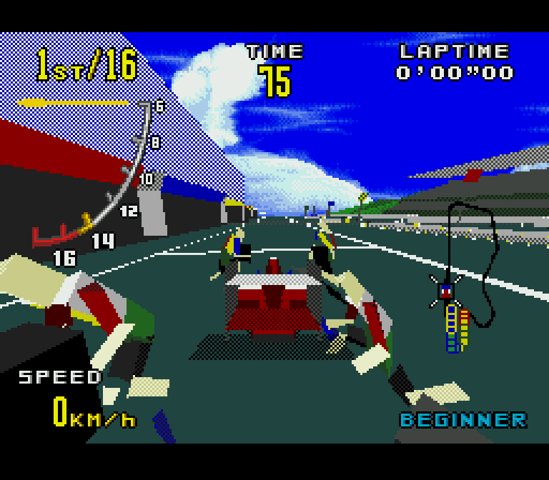
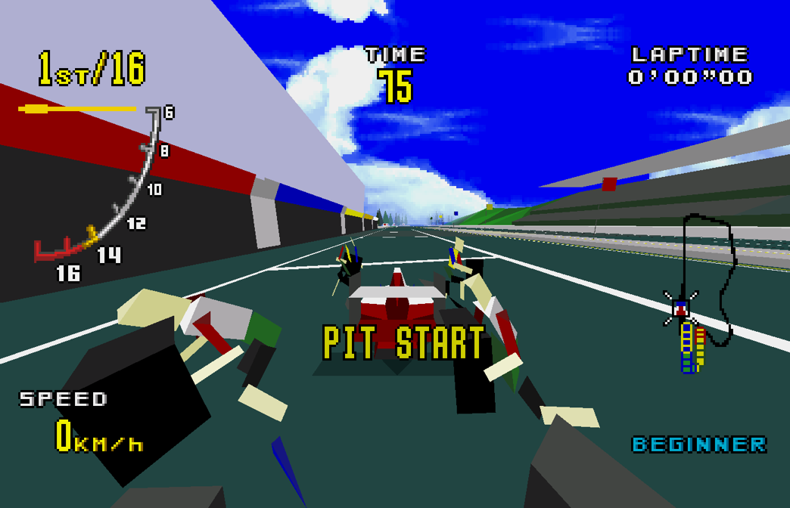
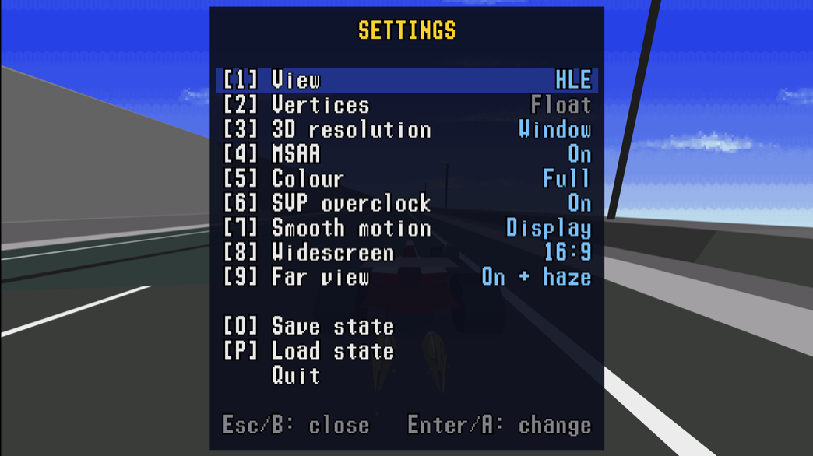

# Virtua Racing MD Enhanced

English | [繁體中文](README.zh-TW.md)

An emulator-based project that runs the original Sega Mega Drive / Genesis version of **Virtua Racing** with enhanced graphics. It is built on the open-source Genesis Plus GX emulator.

Developed with Claude Code (Opus 5.5).

This project is intended for nostalgia and technical research. For an experience closer to the arcade original, try the Nintendo Switch version or the 32X, Saturn and other ports.

> **Unofficial project.** This project is not affiliated with or endorsed by SEGA. Virtua Racing is a trademark of SEGA. No ROMs or ROM-derived assets are included. For non-commercial use only.

## Features

The project uses high-level emulation (HLE) to intercept rendering commands sent by the 68000 CPU to the SVP 3D chip and render the scene on the GPU. This enables several visual and performance enhancements:

- **Higher resolution:** Render the original 256×192 image at higher resolutions and use floating-point rather than integer calculations for 3D vertex projection to reduce polygon jitter.
- **Improved color:** Full-color rendering without the original checkerboard dithering.
- **Higher frame rates:** Go beyond the original 15 FPS with 30 and 60 FPS options, plus lower input latency for more responsive controls.
- **Widescreen:** Choose between the original 4:3 aspect ratio and an expanded 16:9 view.
- **Extended draw distance:** See roughly three times farther than in the original game.
- **In-game menu:** Adjust settings at any time.

<p align="center">
  
  
</p>
<p align="center">Left: the original (4:3, 256×224). Right: enhanced (16:9, extended draw distance with haze).</p>

<p align="center">
  
</p>
<p align="center">The in-game settings menu (Esc).</p>

<p align="center">
  <a href="https://youtu.be/zPLkgRMxFig"></a>
</p>
<p align="center">Demo video on YouTube (click to play).</p>

## ROM

This project does **not** provide any ROM.

Supported version:

| Item | Value |
|---|---|
| Version | Virtua Racing (USA) |
| SHA-1 | `ff969ae53120cc4e7cb1a8a7e47458f2eb8a2165` |
| CRC32 | `7e1a324a` |

## Starting the game

Download a prebuilt release from the Releases page, and have your own ROM ready.
If you prefer to build the executable yourself rather than use the prebuilt binary, see "Building it yourself" in [technical.md](docs/technical.md) for instructions.

### macOS

- Requires an Apple Silicon Mac (M1 or later).
- Install SDL2 using [Homebrew](https://brew.sh): `brew install sdl2`
- Open Terminal, navigate to the folder containing `vrr`, and run:

  ```sh
  ./vrr "Virtua Racing (USA).md"
  ```

- The program is unsigned, so macOS may block it. Go to System Settings → Privacy & Security and select "Open Anyway".

### Windows

- Requires 64-bit Windows 10 or later.
- Keep `vrr.exe` and `SDL2.dll` in the same folder, and drag the ROM file onto `vrr.exe` to start.
- The executable is unsigned and Windows may block it. Select "More info" → "Run anyway".

### Linux

A Makefile is provided. See "Building it yourself" in [technical.md](docs/technical.md) for how to build the binary.

The settings file (`vrr.ini`) and save state (`vrr.gp0`) are stored in the working directory on macOS and Linux, and in the same folder as `vrr.exe` on Windows.

## Controls

| Key | Function |
|---|---|
| Arrow keys | D-pad |
| A / S / D | Pad A / B / C (B is the throttle in a race) |
| Z / X / C | Six-button pad X / Y / Z (change the view in a race) |
| F | Start |
| 1 | View: HLE (default) / original / side by side (original \| HLE) |
| 2 | HLE vertex positions: floating-point projection (default) / the original integer projection |
| 3 | 3D internal resolution: window resolution (default) / 1x / 2x / 4x |
| 4 | Anti-aliasing: on (default) / off |
| 5 | Color: full color (default) / the original 9-bit palette and dithering |
| 6 | SVP overclock: overclocked (default; reduces slowdown under heavy SVP workloads) / original |
| 7 | Smooth motion: 15 FPS / 30 FPS / 60 FPS / display refresh rate (default) |
| 8 | Widescreen: 16:9 / the original 4:3 (default) |
| 9 | Far view: extended with haze (default) / extended / original |
| O | Save the current emulator state to `vrr.gp0` (single slot; overwrites the previous save) |
| P | Load the saved state from `vrr.gp0` |
| Esc | Open the pause menu. Use the arrow keys and Enter to change settings, save or load a state, or quit. Press Esc again to resume |
| Alt+Enter | Toggle fullscreen (borderless, at the desktop resolution) |

Game controllers are supported, including Xbox, PlayStation, Switch Pro, and other SDL-supported controllers.

Face buttons are mapped by physical position to approximate the Mega Drive six-button layout: A, B, and C correspond to the left, bottom, and right buttons, while Z corresponds to the top button.

| Xbox | PlayStation | Switch Pro | Maps to |
|---|---|---|---|
| D-pad, left stick | same | same | D-pad |
| X (left), left trigger | □, L2 | Y, ZL | Pad A |
| A (bottom), right trigger | ✕, R2 | B, ZR | Pad B |
| B (right) | ○ | A | Pad C |
| LB, RB | L1, R1 | L, R | Six-button pad X, Y |
| Y (top) | △ | X | Six-button pad Z |
| Start | Options | + | Start |
| Back (or Guide) | Share / Create (or PS) | − (or Home) | Menu |


## Folders

| Path | Contents |
|---|---|
| `src/` | This project's code |
| `tools/` | Research tools: SSP1601 disassembler, SVP memory access log analysis, VDP layer splitting |
| `docs/` | Technical documents |
| `third_party/genplus-gx/` | Genesis Plus GX's `core/` and `sdl/` frontend. Every change is marked `VRR:` |

## Credits

- **notaz** (Grazvydas Ignotas): SVP emulation and the [SVP documentation](https://segaretro.org/SVP_documentation_(2014-09-23)).
- **Tasco Deluxe**: pioneering SVP research.
- **Devon** (Ralakimus): [Virtua Racing research on Sonic Retro](https://forums.sonicretro.org/threads/sega-virtua-processor-virtua-racing-research.38296/) and [svp-blender](https://github.com/Ralakimus/svp-blender).
- **JaviTaiyou** (Javier de Silóniz Sandino): real-hardware research in [svpdev](https://github.com/jdesiloniz/svpdev).
- **Eke-Eke**: [Genesis Plus GX](https://github.com/ekeeke/Genesis-Plus-GX).

## License

This project's own code and documents are under the terms in [LICENSE](LICENSE): non-commercial use only, the same terms as Genesis Plus GX. The screenshots in `docs/images/` show SEGA's game and are not covered.

## Third-party licenses

This project includes code from [Genesis Plus GX](https://github.com/ekeeke/Genesis-Plus-GX)
at commit `939ce4f045f981f89965f24780cef045cc5e52d7`,
located in `third_party/genplus-gx/`.

Genesis Plus GX is distributed under a non-commercial license.
See `third_party/genplus-gx/LICENSE.txt` for the full terms.

The SVP emulation code in `third_party/genplus-gx/core/cart_hw/svp/` was written by
notaz and is also restricted to non-commercial use.

Any redistribution or modification of these components must
comply with their respective license terms.
